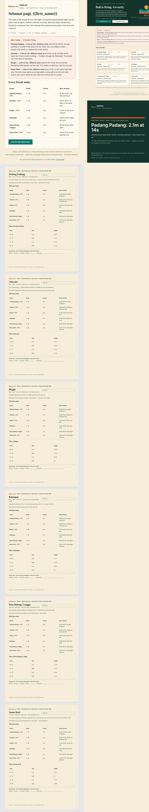
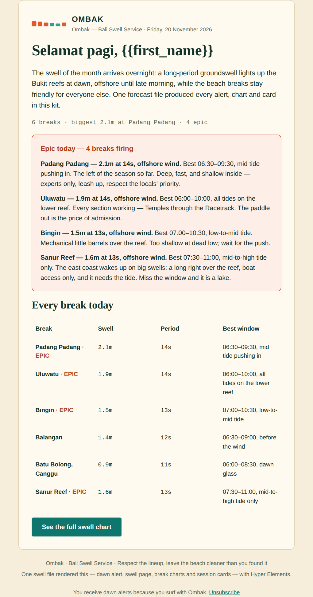
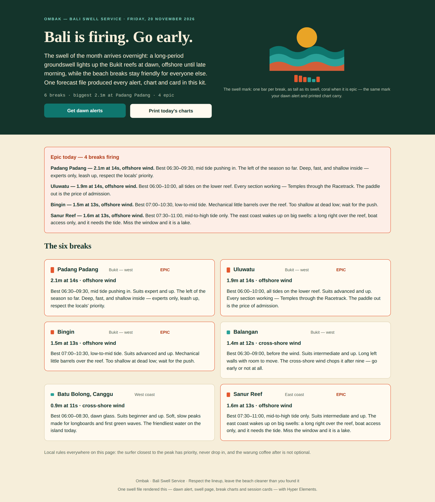
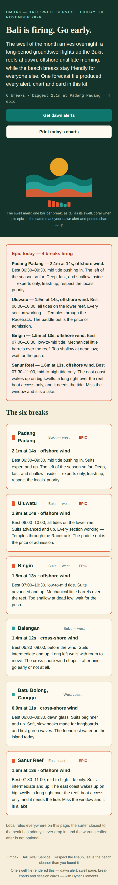
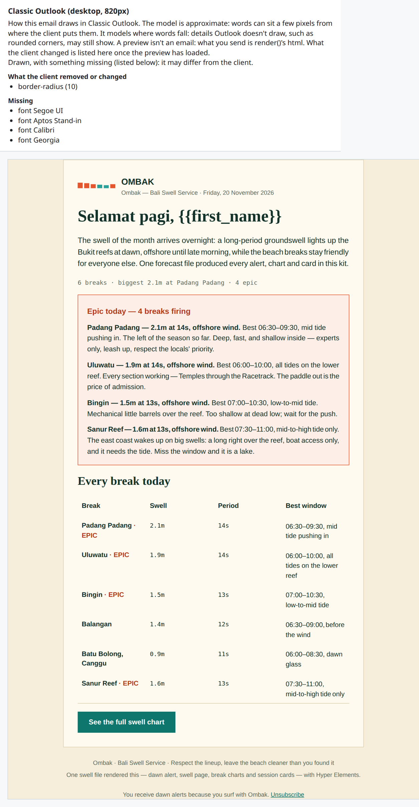
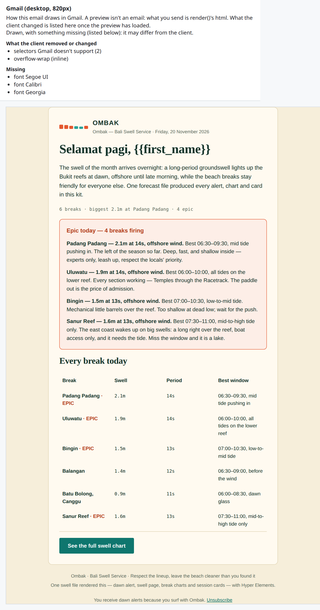

# OMBAK — Every break, every tide

A Hyper Elements template kit for a Bali surf forecast service.
**One swell file** (`src/data/swell.ts`) — six breaks, each with its
swell, period, wind, tides, best window and the level it suits —
renders everything the service publishes that day: the dawn-patrol
alert emails, the public swell page, the printed break charts as a
real PDF, and the session cards — from **one theme** and **one set of
shared components**.



*Every screenshot in this README is a photograph of a real render
(`npm run render` + `npm run shots`): if it is pictured, it was rendered.*

**Measured on the demo run (19 Nov 2026):** one swell file → **180
personalised dawn alerts** (each surfer sees only the breaks at or
below their level), a **6-page break-chart PDF** (one A4 chart per
break, with its full tide table), **6 session cards** (one per break) —
gate at **0 errors, 0 warnings**, batch in **2.9s**. Reproduce it:
`npm run check && npm run make`, then read `out/checks.json` and
`out/batch.json`.

| The dawn alert (600px) | The swell page (desktop) | The swell page (mobile) |
|---|---|---|
|  |  |  |

| The break chart (A4) | The email in Outlook | The email in Gmail |
|---|---|---|
|  |  |  |

The biggest break as a card is in
[`examples/session-card.png`](examples/session-card.png).

## Why one swell file?

A forecast is a promise people paddle out on. If the email says
Padang Padang is 2.1 metres and the chart on the warung wall says
1.4, someone drives an hour on a lie. This kit makes disagreement
impossible by construction: the alert, the page, the chart and the
cards are four roots over one data file. Two rules live in the data,
not in anyone's judgement on the day:

- **"Epic" is computed** — swell ≥ 1.5m, period ≥ 12s, offshore wind —
  so every output flags the same breaks.
- **The level filter is a safety feature.** Each surfer's alert lists
  only breaks at or below their level. A beginner is never sent to
  Padang Padang, because the email they get does not contain it.

The **SwellMark** (one bar per break, as tall as its swell, coral when
epic) is built from a `Grid` of `Column`s, so the same mark survives
an image-blocking inbox, a printed chart and a social card.

## The four outputs

| Output | Root | Script | What it is |
|---|---|---|---|
| Dawn alert | `Email` → `render()` | `templates/dawn-email.tsx` | Per-surfer: epic breaks first, then *their* breaks only, MergeTag greeting ("Selamat pagi"), plain-text twin |
| Swell page | `Page` → `render()` | `templates/swell-page.tsx` | Sunset hero with Svg sun-and-waves art, every break as a typed `ombak.BreakCard`, no client-side JavaScript |
| Break charts | `Document` → `renderPdf()` | `templates/break-charts-document.tsx` | One A4 chart per break to pin on the board rack: numbers, full tide table, session log |
| Session cards | `Canvas` → `renderImage()` | `templates/session-canvas.tsx` | 1080×1080 PNGs, one per break — the swell as the hero number, on poster bands of palm and sunset |

## Run it

```bash
npm install
npm run check        # validate() gate: core + lint + email-clients -> out/checks.json
npm run render       # one of each output -> out/
npm run clients      # the email as Outlook / Gmail / Apple Mail draw it -> out/clients/
npm run make         # the batch: 180 alerts + charts PDF + 6 cards
npm run make:sample  # same, 12 alerts
npm run shots        # screenshots of the real renders -> docs/
npx hyper-elements check templates/   # 4 templates: 0 errors, 0 warnings, 0 skipped
```

Node 20+. The PDF and PNG steps take their fonts as files — see
`assets/fonts/README.md`. Without them the HTML still renders and the
scripts say exactly what is missing; nothing is ever fetched.

## How Hyper Elements is used

- **One `defineTheme()`** for all four roots: sand, palm ink, lagoon
  teal, Georgia display over Inter body, named `card` / `stamp` /
  `mono` styles, Button variants, per-format overrides. No `mobile`
  blocks in the theme — phone styles are an error in a Document or a
  Canvas.
- **Shared components across roots** (`Wordmark`, `SwellMark`,
  `DayLine`, `BreakTable`, `EpicBlock`) — the emailed break and the
  printed break are the same break.
- **Each root plays to its medium.** The Page gets full `Svg`
  sun-and-waves art; the Email, which cannot hold an Svg, gets the
  SwellMark as layout instead.
- **A custom element with `defineElement()`**: `ombak.BreakCard`,
  typed props via `prop.text` / `prop.number` / `prop.choice` /
  `prop.boolean`. A mistyped swell height is a diagnostic with a path,
  before anything renders.
- **`validate()` as a gate**: the batch validates before writing a
  single file; `out/checks.json` makes the verdict an artefact.
- **Token scopes for the dark grounds**: the Page hero and the Canvas
  card invert via `tokens` on a Section/Column.
- **Deterministic batch**: surfer generation uses no clock and no
  randomness, so a corrections run re-renders only changed records.

## Structure

```
src/theme.ts                  the one theme
src/data/swell.ts             the one swell file (+ surfers)
src/components/shared.tsx     components shared by all four outputs
src/components/break-card.tsx ombak.BreakCard (defineElement)
templates/                    one default-exported component per output
scripts/                      check / render / clients / make / shots
examples/                     one real artefact of each kind
docs/                         design notes, screenshots
AGENTS.md                     ten invariants an agent must not break
```

## Data & privacy

The breaks are Bali's real geography (Padang Padang, Uluwatu, Bingin,
Balangan, Batu Bolong, Sanur Reef); the forecast figures are
illustrative sample data generated in this repository, not a real
forecast. All surfers are fictional. No network calls, no credentials,
no paid services.

## License

MIT — see `LICENSE`.
